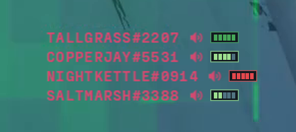

# Marathon Sleaze Detector

Marathon Sleaze Detector is designed for Bungie's extraction shooter Marathon. This software lets you remember runners who backstabbed you and view which runners backstabbed others in the past to make sure you don't fall for the same runners again. This project displays a crowdsourced trust metric next to each username in the ping, kill, or prox feed letting you know whether you should trust a runner before agreeing to team up.

<!-- Example image -->

   
  
  Not actual gameplay; synthetic image generated to show what it looks like in-game
  

### Install
1. Download the latest installer [here](https://github.com/Reginald-Gillespie/MarathonSleazeDetector/releases).
2. Run the installer. 
3. Sign in with Steam to rate users.

### Features
- Shows trust meter next to each username.
- Allows you to rate runners post-run.
- Rook-specific flags are taken into account when you are running as Rook.

### Is it safe? / Will it get me banned?

SleazeDetector is safe. It never modifies game files and never tampers with game memory. It only reads from your screen and displays trust meters on top of the game. It gives no gameplay advantage.

### Privacy
What we collect and why:
- Steam ID: login is required to prevent users from spamming anonymous negative reviews. Only one review is allowed per runner per Steam account.
- Usage pings: we track the last day each signed in user used SleazeDetector to make sure we do not need to move to a more expensive server plan.
- Encountered runner's names are sent to the server even when not signed in to lookup their ratings. These usernames are not stored unless explicitly rated. 
- Your reviews: these are collected to share with others. Your information is not shared, only the total result of the ratings is shared.
- Comments sent with submissions can be made public at the choice of Moderators. They will not often be public, however treat it as public.

### Dispute a rating
If you believe something is incorrect, DM me on discord (username: `wk0a`) or file an issue in the issues tab.

### Known Issues:
- This app is in very early stages of development.
- Very similar usernames could be collapsed into the same user. This will be handled once this problem arises.
- See the issues tab for more.
- Some characters cannot be processed, for example Chinese names. These are lower priority and require rebuilding the ML model used for name recognition.

<!-- 

## Support the project
<Donation link(s), and what donations pay for (hosting the shared ratings).>

I won't ask for donations until usage exceeds the cloudflare worker free tier. 
-->

This project is dedicated to the sleazeball who stabbed me in the back as we were rooking it together because "I want your stuff." You know who you are.
